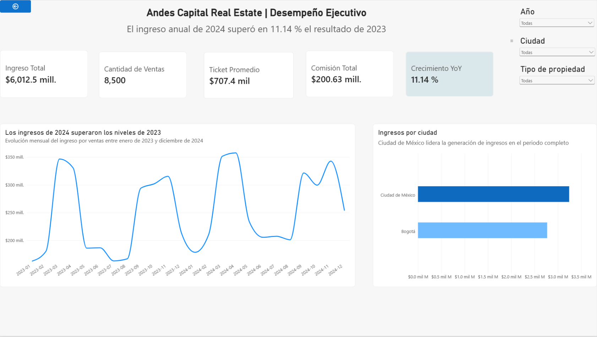
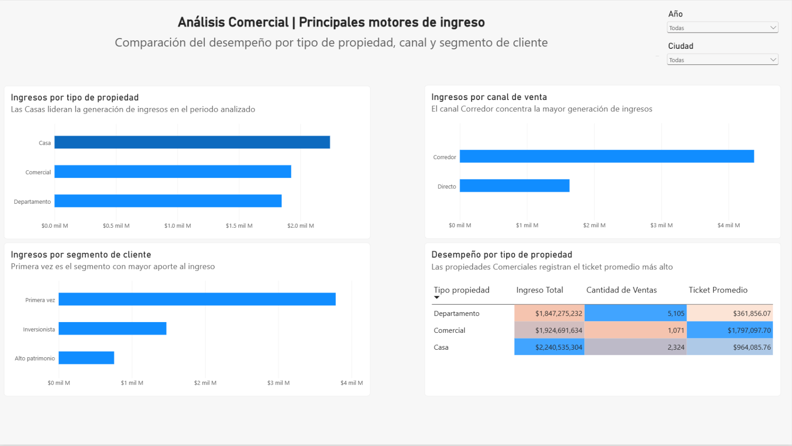
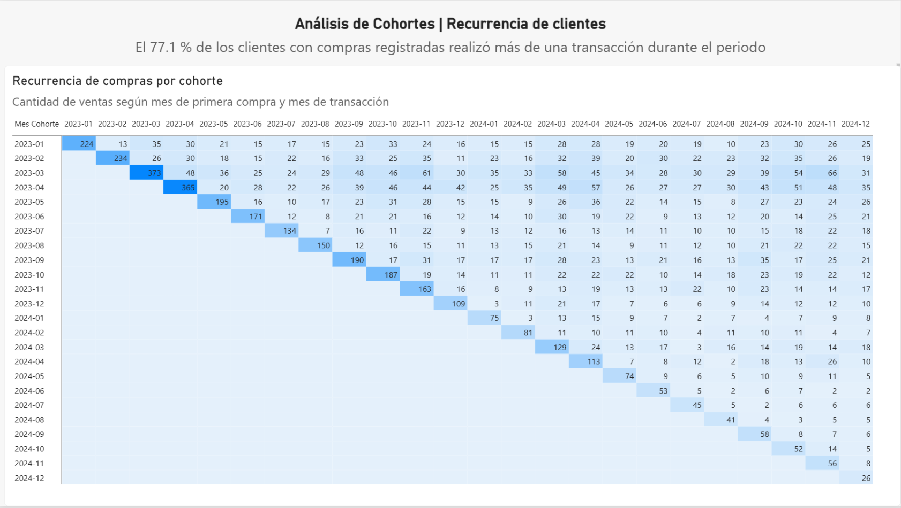
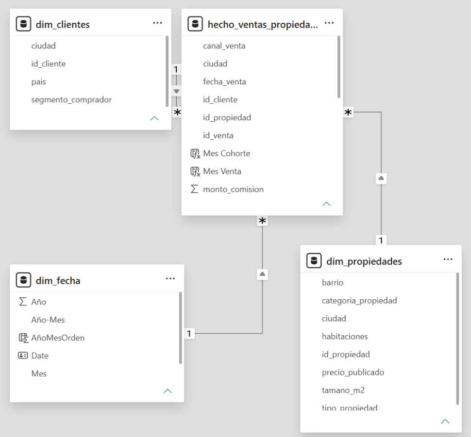

# Andes Capital | Análisis comercial inmobiliario con Power BI

Este dashboard reúne las ventas inmobiliarias de 2023 y 2024 para entender cómo cambian los ingresos, qué tipos de propiedad y canales aportan más al negocio y cómo se comportan los clientes después de su primera compra.

Lo desarrollé en **Power BI**, con un modelo de datos en estrella, medidas DAX y tres páginas de análisis.

## Vista general

El informe permite consultar los resultados por año, ciudad y tipo de propiedad. Entre los indicadores principales están el ingreso total, la cantidad de ventas, el ticket promedio, las comisiones y el crecimiento respecto al año anterior.

En los datos analizados se registran **8,500 ventas**, ingresos por aproximadamente **6,012.5 millones** y un **crecimiento interanual del 11.14 %** en 2024 frente a 2023.

## Análisis comercial

Comparé los ingresos por tipo de propiedad, canal de venta y segmento de comprador. Las **casas** concentran el mayor ingreso total, mientras que las propiedades **comerciales** presentan el ticket promedio más alto. También se observa que el canal de **corredores** aporta más ingresos que el canal directo.

La tabla permite distinguir entre volumen de operaciones y valor promedio: los **departamentos** registran la mayor cantidad de ventas, pero no el ticket más alto.

## Cohortes y recurrencia

Agrupé las transacciones por mes de primera compra y mes de venta. La matriz muestra cuántas operaciones corresponden a cada cohorte a lo largo del tiempo.

En el periodo analizado, **77.1 % de los clientes con compras registradas realizaron más de una transacción**. Este indicador describe recurrencia en el conjunto de datos; **no equivale a una tasa de retención mensual**.

## Modelo de datos

El modelo contiene una tabla de hechos, `hecho_ventas_propiedades`, conectada mediante relaciones **uno a muchos** con tres dimensiones:

- `dim_clientes`: ciudad, país y segmento de comprador.
- `dim_propiedades`: tipo de propiedad y características del inmueble.
- `dim_fecha`: calendario para analizar la evolución de las ventas.

Entre las medidas utilizadas están **Ingreso Total**, **Cantidad de Ventas**, **Ticket Promedio**, **Comisión Total** y **Crecimiento YoY**. Para la comparación anual utilicé `CALCULATE`, `REMOVEFILTERS` y `DIVIDE`.

## Archivos

- `Andes_Capital_Dashboard.pbix`: informe editable para abrir en Power BI Desktop.
- `imagenes/`: capturas de las tres páginas y del modelo de datos.

Para explorar los filtros y las medidas, descarga el archivo `.pbix` y ábrelo con **Power BI Desktop**. Las imágenes permiten consultar el trabajo sin instalar el programa.

*Proyecto desarrollado durante mi formación en análisis de datos con TripleTen. Los resultados corresponden a un conjunto de datos de práctica; no representan cifras de una empresa real.*
